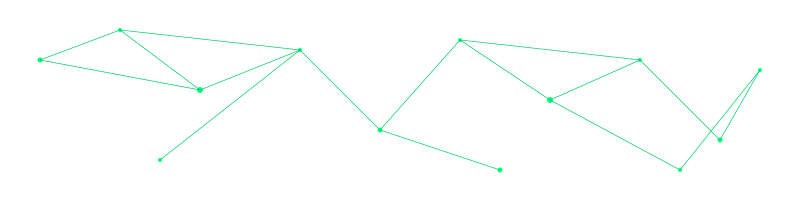

  

---

### whoami

Low-level security, the defensive side. Learning how Windows executables
really work - one byte at a time - so I can analyze what others only run.

Building: [pe_tool](https://github.com/defensivearchitect/pe_tool) - a
from-scratch PE parser in C, built to stay safe on untrusted, malformed
binaries (bounded reads, tested against hostile input).

Focus: PE & Windows Internals - memory forensics - detection engineering - threat hunting

Learning now: parser security - x86-64 assembly - reverse engineering
